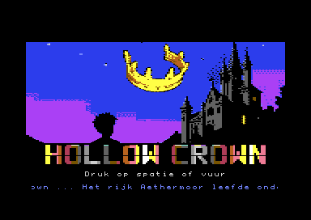
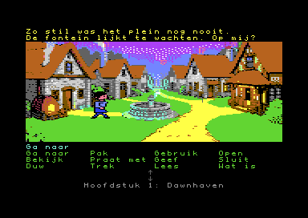
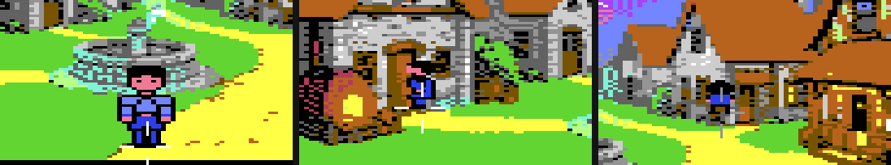

# 👑 Hollow Crown

```text
    **** COMMODORE 64 BASIC V2 ****
 64K RAM SYSTEM  38911 BASIC BYTES FREE

READY.
LOAD"HOLLOW CROWN",8,1

SEARCHING FOR HOLLOW CROWN
LOADING
READY.
RUN
```

> *The sun has been spelled away. The lantern is empty. The wolves are waiting.*
> *Somebody hand Eldric a jug.*

**Hollow Crown** is a point-and-click adventure for the **Commodore 64**, written from scratch in 6502 assembly.
It plays the way the classic late-80s C64 adventures did: the room on top, a bar of verbs below, and a cursor
you use to build sentences like **"Use jug with barrel"**. The story, world, characters, art, music and code are
all our own. We borrow only the genre and the way you control it.







*Eldric mid-stride on his way round the fountain (top), and at three depths (above), running in VICE. Messages on top, Dawnhaven as a 160×128
multicolour room, the verb bar below (in Dutch for now). The test suite checks this screen pixel by pixel against
what memory says it should be.*

---

## 📜 The story

Long ago the sun shone over **Aethermoor**. Deep under the mountains lived the **earth folk**: small, hollow
creatures with glowing eyes who cannot bear daylight. Their master, **Grom the troll wizard**, wanted a home for his
people above ground. On the night of the double lunar eclipse he spoke his spell, and ever since the land has been
stuck in an endless dusk.

You are **Eldric**, an ordinary boy from Dawnhaven with a good heart and a warm little stone from his grandmother,
with a bit of the old sun still in it. No hero, no knight. He grows along the way, and in the end he is the one who
makes the sun shine again, without a single fight. Shadow wolves, ghost knights and worse are puzzles to be solved,
not monsters to be hit.

| Who | What |
|---|---|
| **Eldric** | You. An ordinary boy with a good heart and grandma's sunstone |
| **Mira** | A blind woman in Dawnhaven who *sees* paths, once she has her seeing stone back |
| **Bram** | The smith. Grumpy, big heart |
| **Grom** | The troll wizard who stole the light, for his people. Not evil, just wrong |

**Chapters:** Dawnhaven → Darkwood → Sea of Oblivion → Rock Gorge → Ice Peak → The Forgotten Castle.

Chapter 1 (*Dawnhaven*) comes first: four rooms, one chain of puzzles, no dead ends and no deaths. Chapter 2
(*Darkwood*) adds four hand-drawn rooms and the first deaths: Tik, a little white time-keeper, offers to rewind to
the moment you entered the room.

---

## 🖥️ The screen

```text
row  0-1   messages: what a character says, in their own colour
row  2-17  the room: 160 × 128 multicolour bitmap
row 18     sentence line:  "Use jug with barrel"
row 19-21  12 verbs (3 × 4)
row 22-23  inventory, with ↑ ↓ arrows
row 24     chapter name
```

```text
Walk to     Pick up     Use         Open
Look at     Talk to     Give        Close
Push        Pull        Read        What is
```

*(In game the verbs are in Dutch for now; English comes later.)*

Three raster interrupts per frame switch between text, bitmap and text. Joystick, mouse and keyboard all work,
at the same time:

| | Move | Fire |
|---|---|---|
| Joystick (port 2) | stick | fire button |
| 1351 mouse (port 1) | mouse | left button |
| Keyboard | **CRSR** keys, with **SHIFT** for up/left (arrow keys in VICE) | **SPACE** or **CTRL** (left Control in VICE), also RETURN |
**F1** toggles music, **F5** saves, **F7** loads, and **space** skips text you've already read.
Move the cursor to the top line for the menu: **Bestand** (save, load, exit to BASIC), **Score** (light points)
and **Bosskey**, which instantly turns the screen into a very boring spreadsheet. Any key brings the game back.

---

## ⚙️ Under the hood

The game is a small **SCUMM-style engine**. The engine is generic; the game itself is data and scripts.

- **Rooms:** one compressed file per room on the disk (picture, foreground sprite, patches such as an opened
  door), loaded with the Kernal into a fixed buffer at `$A000`. Only the village square has real FLUX art so far;
  the tavern, smithy and forest edge use temporary drawn pictures (`tools/maak_kamers.py`) until FLUX art exists.
- **Foreground:** Eldric can walk *behind* things. The fountain's stone column is also a sprite with a lower
  number than Eldric's, switched on only while his feet stand behind it. The column in the bitmap gets exactly the
  sprite's colours, so you never see the switch, and the rest of the picture keeps all its colours.
- **Walkboxes:** rectangles with a neighbour graph. Paths are found with BFS, then Eldric walks in straight lines.
- **Actors:** two multicolour sprites stacked on top of each other, with poses copied into sprite slots on change.
  Actors **shrink with depth**: five sizes per pose, picked from the depth of their feet, so Eldric fits through
  the doors at the back of a room and walks a little slower there. The C64 cannot scale sprites, so the sizes are
  pre-made by the costume tool (the two smallest are hand-drawn).
- **Languages:** Dutch first. English and French follow later as their own disks from the same engine: every
  line the player reads lives in the scripts and a small text file, never in the engine code.
- **Scripts:** plain-text `.hcs` files, compiled by a Python compiler into bytecode for a tiny VM. The compiler
  also checks that chapter 1 can actually be finished.
- **Testing without hands:** an `AUTOTEST` build replays *input tapes* (cursor moves, fire, waits). VICE runs them
  and the test reads the game state straight from memory. A test only passes when the state is correct;
  a pretty screenshot alone doesn't count.

**Memory map (VIC bank 3):** program `$0801-$BFFF`, screen `$C000`, sprites `$C400`, bitmap `$E000` and font
`$F800`, both under the Kernal ROM. With the font there, one `$d018` value serves text and bitmap alike, so the
raster splits only touch `$d011` and `$d016`.

---

## 🧰 Toolchain

| Tool | Version | Used for |
|---|---|---|
| [Kick Assembler](http://theweb.dk/KickAssembler/) | 5.14 (`tools/KickAss.jar`) | 6502 assembly |
| Java (OpenJDK) | 17+ (tested on 27) | Runs Kick Assembler |
| [VICE](https://vice-emu.sourceforge.io/) | 3.10 (`x64sc`, `c1541`) | Emulation (PAL), disk images, automated tests |
| Python | 3.9+ with Pillow | Sprite, room, script and music tools |

On macOS, `/usr/bin/java` is only a stub. Use a real JDK, for example `brew install openjdk`.
Tool paths live in one place, at the top of `build.sh` and `tools/vicetest.py` (or set `JAVA` / `VICE_BIN`).

```bash
./build.sh                              # build/hollowcrown.d64 + _2.d64 (1541, two disks) and build/hollowcrown.d71 (1571, one disk)
./build.sh --vice                       # ...and start it in VICE
./tests/alles.sh                        # every test: compiler errors + every input tape in VICE
```

---

## 🗂️ Project layout

```text
src/        the engine (*.asm)
scripts/    the game itself (*.hcs)
data/       FLUX art, rooms, music
tools/      Kick Assembler, converters, script compiler, test runner
tests/      input tapes and expected outcomes
docs/       development log and reference material
build/      everything the build produces (generated, not in git)
oud/        old experiments ("oud" is Dutch for "old")
```

---

## 🚧 Status

The whole game is playable, from the title screen through all six chapters to the final scene on the castle roof. It comes on two 1541 disks (D64; the game asks for disk 2 when it needs it) or on one double-sided 1571 disk (D71, no disk swap). The fast loader works on both drives. Automated tests boot it in VICE,
play input tapes (one of them plays the whole chapter, another saves, loads and carries on), check the game state and
compare every screenshot pixel by pixel with the screen as memory says it should be, sprites included. The engine is being built
in this order:

- [x] 0. Setup: build script, memory map with asserts, D64, test runner
- [x] 1. The split screen and the cursor
- [x] 2. Eldric walks (walkboxes, pathfinding)
- [x] 3. Objects and the sentence line
- [x] 4. Script VM and compiler
- [x] 5. Inventory
- [x] 6. More rooms, loading from disk
- [x] 7. Conversations
- [x] 8. Foreground masking and small animations (flickering fire)
- [x] 9. Chapter 1, fully playable (sound effects, save/load with F5/F7, finale)
- [x] 10. Title screen with original SID music (own theme in D minor, checked note by note against the SID)
- [x] 11. Chapter 2, *Darkwood*: chapters, deaths and rewinding (Tik), Mira follows Eldric, scripts per room on disk
- [x] 12. Chapters 3-6 and a cutscene between every two chapters; two disks; the fog of forgetting
- [x] 13. Turbo loader: our own 2-bit fast loader for the 1541 (about twice as fast as the Kernal; falls back to the Kernal when there is no real drive)
- [x] 14. One-disk version for the 1571 (D71)

Progress notes are in [`docs/LOGBOEK.md`](docs/LOGBOEK.md) (in Dutch).

---

## 🙏 Inspiration

Hollow Crown owes its *genre* to the Lucasfilm Games adventures of the 1980s and to the modern C64 adventure
*Caren and the Tangled Tentacles*. We read about how those games were built; we don't copy their code, art,
text or music.

```text
READY.
█
```
