# 👑 Hollow Crown

```text
    **** COMMODORE 64 BASIC V2 ****
 64K RAM SYSTEM  38911 BASIC BYTES FREE

READY.
LOAD"HOLLOW CROWN",8,1

SEARCHING FOR HOLLOW CROWN
LOADING
READY.
RUN
```

> *The sun has been spelled away. The lantern is empty. The wolves are waiting.*
> *Somebody hand Eldric a jug.*

**Hollow Crown** is a point-and-click adventure for the **Commodore 64**, written from scratch in 6502 assembly.
It plays the way the classic late-80s C64 adventures did: the room on top, a bar of verbs below, and a cursor
you use to build sentences like **"Use jug with barrel"**. The story, world, characters, art, music and code are
all our own. We borrow only the genre and the way you control it.

**Play it:** download `hollowcrown.crt` from the [latest release](https://github.com/mfidder2026/hollow_crown64/releases/latest)
and attach it as a cartridge (VICE: `x64sc -cartcrt hollowcrown.crt`, or drag it onto the window; real hardware: an
EasyFlash). It starts with a language menu: **English, Deutsch, Français** or **Nederlands**. Everything comes from the
cartridge, so rooms appear instantly. Saving (F5/F7) needs a disk drive.

<p align="center">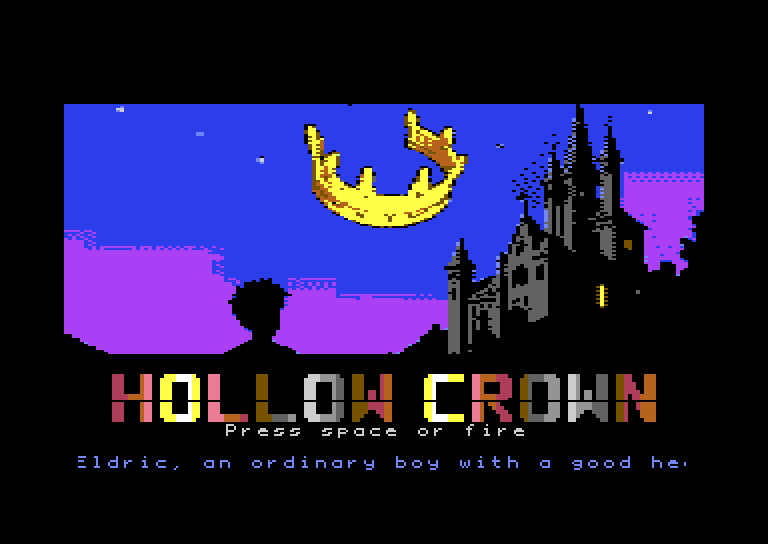</p>

### 🖼️ Gallery

| | |
|:---:|:---:|
| 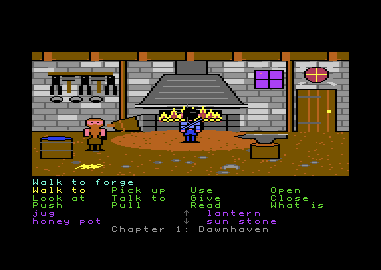 | 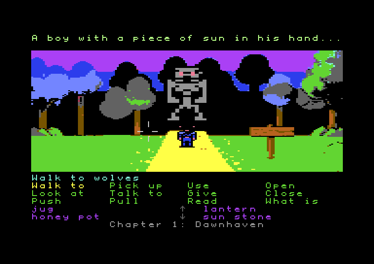 |
| *Chapter 1: Bram's smithy in Dawnhaven* | *Grom, the troll wizard, at the edge of Darkwood* |
| 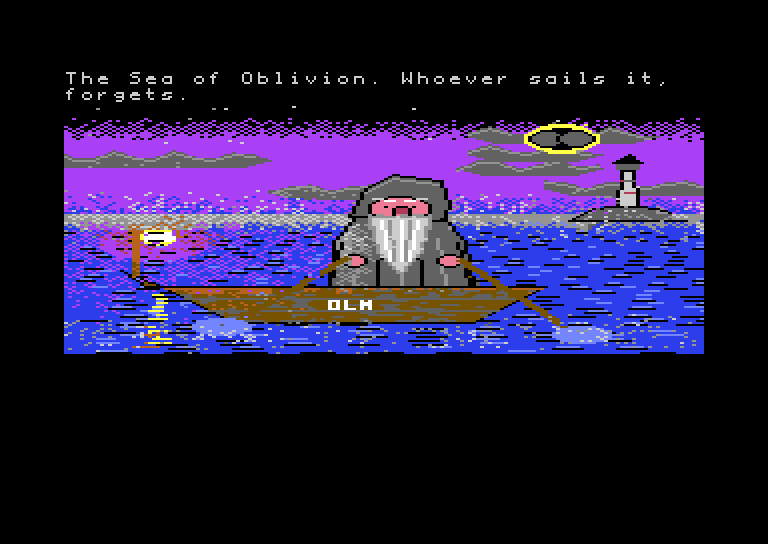 | 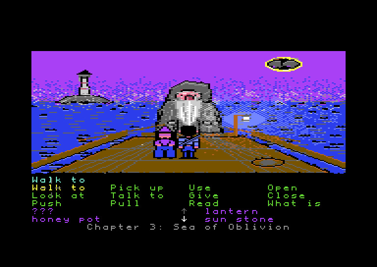 |
| *Chapter 3: Olm the ferryman* | *The fog of forgetting: every half minute Eldric loses a name* |
| 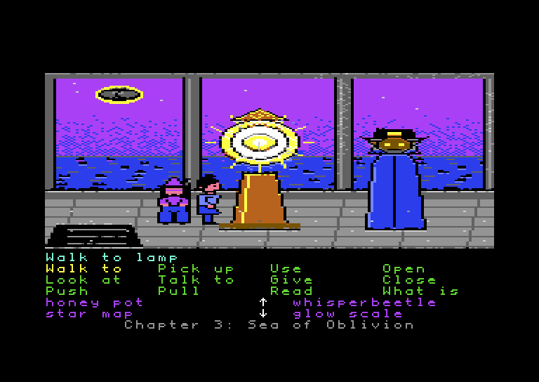 | 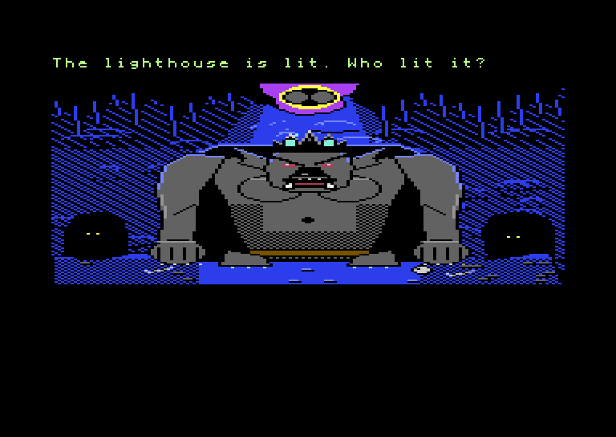 |
| *The lighthouse lamp burns again* | *A cutscene: Grom in his cave, with the Hollow Crown* |
| 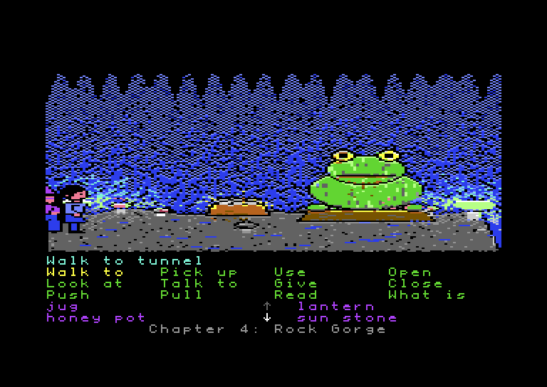 | 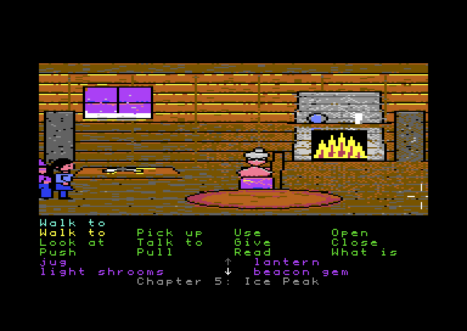 |
| *Chapter 4: Pad the toad trades glowing mushrooms* | *Chapter 5: Granny Rime's hut on the Ice Peak* |
| 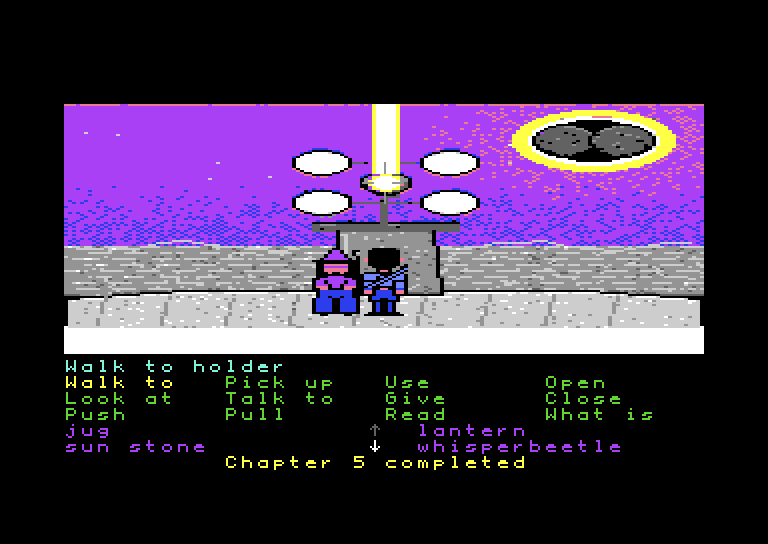 | 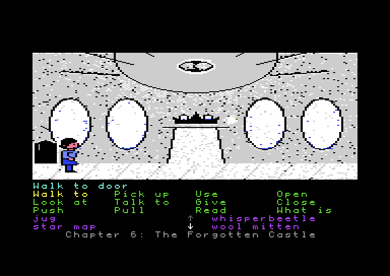 |
| *The sun beacon catches the light* | *Chapter 6: the moon chamber of the Forgotten Castle* |

<p align="center">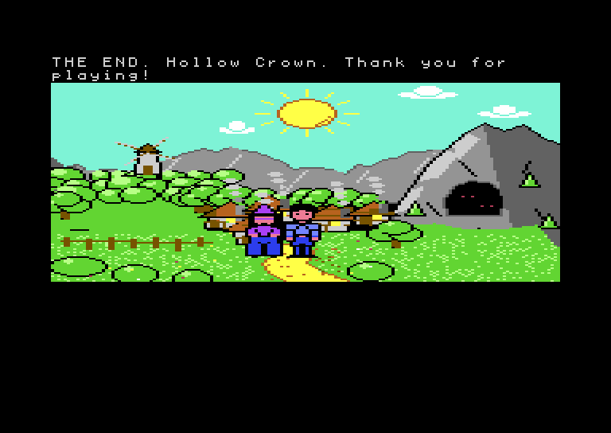</p>
<p align="center"><i>The epilogue: a year later, the sun shines over Aethermoor again.</i></p>

---

## 📜 The story

Long ago the sun shone over **Aethermoor**. Deep under the mountains lived the **earth folk**: small, hollow
creatures with glowing eyes who cannot bear daylight. Their master, **Grom the troll wizard**, wanted a home for his
people above ground. On the night of the double lunar eclipse he spoke his spell, and ever since the land has been
stuck in an endless dusk.

You are **Eldric**, an ordinary boy from Dawnhaven with a good heart and a warm little stone from his grandmother,
with a bit of the old sun still in it. No hero, no knight. He grows along the way, and in the end he is the one who
makes the sun shine again, without a single fight. Shadow wolves, ghost knights and worse are puzzles to be solved,
not monsters to be hit.

| Who | What |
|---|---|
| **Eldric** | You. An ordinary boy with a good heart and grandma's sunstone |
| **Mira** | A blind woman in Dawnhaven who *sees* paths, once she has her seeing stone back |
| **Bram** | The smith. Grumpy, big heart |
| **Grom** | The troll wizard who stole the light, for his people. Not evil, just wrong |

**Chapters:** Dawnhaven → Darkwood → Sea of Oblivion → Rock Gorge → Ice Peak → The Forgotten Castle.

Chapter 1 (*Dawnhaven*) comes first: four rooms, one chain of puzzles, no dead ends and no deaths. Chapter 2
(*Darkwood*) adds four hand-drawn rooms and the first deaths: Tik, a little white time-keeper, offers to rewind to
the moment you entered the room.

---

## 🖥️ The screen

```text
row  0-1   messages: what a character says, in their own colour
row  2-17  the room: 160 × 128 multicolour bitmap
row 18     sentence line:  "Use jug with barrel"
row 19-21  12 verbs (3 × 4)
row 22-23  inventory, with ↑ ↓ arrows
row 24     chapter name
```

```text
Walk to     Pick up     Use         Open
Look at     Talk to     Give        Close
Push        Pull        Read        What is
```

*(The verbs, like every text, follow the language you pick at the start: English, German, French or Dutch.)*

Three raster interrupts per frame switch between text, bitmap and text. Joystick, mouse and keyboard all work,
at the same time:

| | Move | Fire |
|---|---|---|
| Joystick (port 2) | stick | fire button |
| 1351 mouse (port 1) | mouse | left button |
| Keyboard | **CRSR** keys, with **SHIFT** for up/left (arrow keys in VICE) | **SPACE** or **CTRL** (left Control in VICE), also RETURN |
**F1** toggles music, **F5** saves, **F7** loads, and **space** skips text you've already read.
Move the cursor to the top line for the menu: **File** (save, load, and on the cartridge: back to the language
menu), **Score** (light points) and **Bosskey**, which instantly turns the screen into a very boring spreadsheet.
Any key brings the game back.

---

## ⚙️ Under the hood

The game is a small **SCUMM-style engine**. The engine is generic; the game itself is data and scripts.

- **Rooms:** 50 rooms, one compressed file per room (picture, foreground sprite, patches such as an opened door),
  copied into a fixed buffer at `$A000`, plus a file with the room's scripts at `$B600`. Most rooms are drawn by
  hand in Python as C64 pixel art (`tools/teken_*.py`, with texture, light and shadow from `tools/rijk.py`); between
  the places you travel through walking screens: fields, a brook, a maze in the forest, sailing past sea stacks,
  lighthouse stairs, cave tunnels, snow fields and castle corridors.
- **Cartridge:** an EasyFlash image of 1 MB (`tools/crt.py`). The boot code in bank 0 shows the language menu and
  copies that language's program into RAM; rooms are copied straight from the cartridge banks (`src/cartridge.asm`).
  The disk versions (three 1541 disks, two 1571 disks) are still built and tested, with our own 2-bit fast loader.
- **Foreground:** Eldric can walk *behind* things. The fountain's stone column is also a sprite with a lower
  number than Eldric's, switched on only while his feet stand behind it. The column in the bitmap gets exactly the
  sprite's colours, so you never see the switch, and the rest of the picture keeps all its colours.
- **Walkboxes:** rectangles with a neighbour graph. Paths are found with BFS, then Eldric walks in straight lines.
- **Actors:** two multicolour sprites stacked on top of each other, with poses copied into sprite slots on change.
  Actors **shrink with depth**: five sizes per pose, picked from the depth of their feet, so Eldric fits through
  the doors at the back of a room and walks a little slower there. The C64 cannot scale sprites, so the sizes are
  pre-made by the costume tool (the two smallest are hand-drawn).
- **Languages:** every line the player reads lives in the scripts and a small text file, never in the engine code.
  `tools/taal.py` extracts all 959 texts; each language is a JSON file of translations (English, German, French),
  checked against the screen's limits (two lines of 40 characters, names of 13). The font has the accented letters.
- **Scripts:** plain-text `.hcs` files, compiled by a Python compiler into bytecode for a tiny VM. The compiler
  also checks that chapter 1 can actually be finished.
- **Testing without hands:** an `AUTOTEST` build replays *input tapes* (cursor moves, fire, waits). VICE runs them
  and the test reads the game state straight from memory. A test only passes when the state is correct;
  a pretty screenshot alone doesn't count.

**Memory map (VIC bank 3):** program `$0801-$9FFF`, room buffer `$A000-$BFFF`, screen `$C000`, sprites `$C400`,
buffers `$C600-$CFFF`, costumes of the other characters in the RAM under the I/O at `$D000`, bitmap `$E000` and
font `$F800`, both under the Kernal ROM. With the font there, one `$d018` value serves text and bitmap alike, so the
raster splits only touch `$d011` and `$d016`.

---

## 🧰 Toolchain

| Tool | Version | Used for |
|---|---|---|
| [Kick Assembler](http://theweb.dk/KickAssembler/) | 5.14 (`tools/KickAss.jar`) | 6502 assembly |
| Java (OpenJDK) | 17+ (tested on 27) | Runs Kick Assembler |
| [VICE](https://vice-emu.sourceforge.io/) | 3.10 (`x64sc`, `c1541`) | Emulation (PAL), disk images, automated tests |
| Python | 3.9+ with Pillow | Sprite, room, script and music tools |

On macOS, `/usr/bin/java` is only a stub. Use a real JDK, for example `brew install openjdk`.
Tool paths live in one place, at the top of `build.sh` and `tools/vicetest.py` (or set `JAVA` / `VICE_BIN`).

```bash
./build.sh                              # build/hollowcrown.crt (EasyFlash, all languages), D64s (1541) and D71s (1571)
./build.sh --vice                       # ...and start it in VICE
./tests/alles.sh                        # every test: compiler errors + every input tape in VICE
```

---

## 🗂️ Project layout

```text
src/        the engine (*.asm)
scripts/    the game itself (*.hcs)
data/       room pictures (data/plaatjes), room list, music
tools/      Kick Assembler, drawing scripts, converters, script compiler, translations (tools/taal), test runner
tests/      input tapes and expected outcomes
docs/       development log and reference material
build/      everything the build produces (generated, not in git)
oud/        old experiments ("oud" is Dutch for "old")
```

---

## 🚧 Status

The whole game is playable in four languages, from the title screen through all six chapters to the epilogue. It
comes as one cartridge (EasyFlash, with a language menu), and for the Dutch version also on three 1541 disks or two
1571 disks (with our own fast loader). Automated tests boot it in VICE,
play input tapes (one of them plays the whole chapter, another saves, loads and carries on), check the game state and
compare every screenshot pixel by pixel with the screen as memory says it should be, sprites included. The engine is being built
in this order:

- [x] 0. Setup: build script, memory map with asserts, D64, test runner
- [x] 1. The split screen and the cursor
- [x] 2. Eldric walks (walkboxes, pathfinding)
- [x] 3. Objects and the sentence line
- [x] 4. Script VM and compiler
- [x] 5. Inventory
- [x] 6. More rooms, loading from disk
- [x] 7. Conversations
- [x] 8. Foreground masking and small animations (flickering fire)
- [x] 9. Chapter 1, fully playable (sound effects, save/load with F5/F7, finale)
- [x] 10. Title screen with original SID music (own theme in D minor, checked note by note against the SID)
- [x] 11. Chapter 2, *Darkwood*: chapters, deaths and rewinding (Tik), Mira follows Eldric, scripts per room on disk
- [x] 12. Chapters 3-6 and a cutscene between every two chapters; two disks; the fog of forgetting
- [x] 13. Turbo loader: our own 2-bit fast loader for the 1541 (about twice as fast as the Kernal; falls back to the Kernal when there is no real drive)
- [x] 14. One-disk version for the 1571 (D71)
- [x] 15. Walking screens between the rooms: fields, a brook, a forest maze, sailing past sea stacks, lighthouse stairs, cave tunnels, snow fields, castle corridors
- [x] 16. Cartridge (EasyFlash, 1 MB): everything in one file, instant loading
- [x] 17. English, German and French, chosen from a menu at start-up; an epilogue and THE END

Progress notes are in [`docs/LOGBOEK.md`](docs/LOGBOEK.md) (in Dutch).

---

## 🙏 Inspiration

Hollow Crown owes its *genre* to the Lucasfilm Games adventures of the 1980s and to the modern C64 adventure
*Caren and the Tangled Tentacles*. We read about how those games were built; we don't copy their code, art,
text or music.

```text
READY.
█
```
